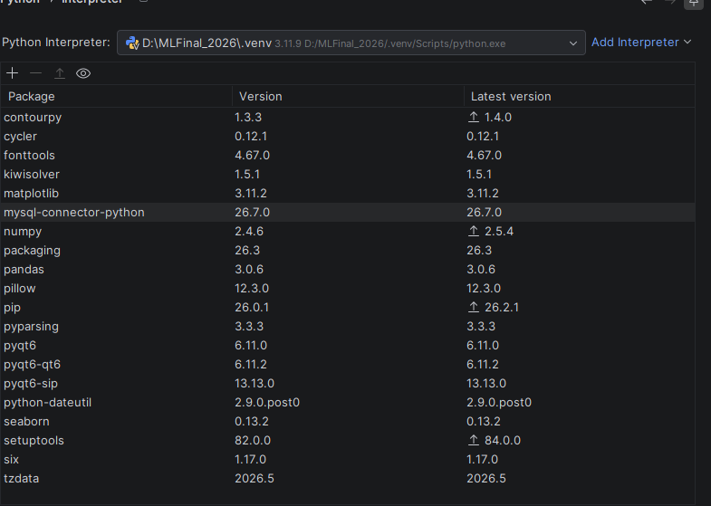

Cách tạo nhập database:
có 2 file database (databaseFinal.sql và FinalDatabase.csv)  (100.000 dòng) trong file database chọn 1 trong 2 up lên mysql workbench của mình
--------------------
Cách pull và push dữ liệu lên github 
Pull dữ liêu: 
    B1: Cài Git từ git-scm.com. ( kiểm tra github: mở cmd và nhập git --version)
    B2: Tạo folder "MLFinal_2026" và nhập vào cmd:  **git clone https://github.com/Quyss2/ML2026_Final.git**
(trường hợp đã pull lần 1 và anh có push bản mới thì nhập vào cmd: **git pull** không cần pull lại từ đầu
--------------------
Push dữ liệu: 
    B1: vào cmd 
    B2: Nhập lần lượt vào cmd: 
\n git add . 
git status
git commit -m "<đặt tên cho version + tên của người đăng>"
git remote add origin https://github.com/ten-cua-ban/ten-repo.git
git push -u origin main
Các thư viện cần cài:  
